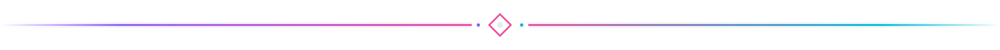

# profile-assets

Les images de mon profil GitHub (bannière, avatar, icônes, séparateurs), rangées ici pour pouvoir les afficher dans mes README.

## Contenu

| Dossier | Contenu |
|---|---|
| `avatar/` | la photo de profil |
| `banner/` | la bannière du profil |
| `icons/` | 15 icônes de technologies en SVG : Docker, Git, Python, React, TypeScript, Linux… |
| `illustrations/` | une illustration « développeur GitHub » |
| `separators/` | 20 séparateurs décoratifs en SVG : néon, circuit, vague, étoiles, terminal… |

## Utilisation

Chaque fichier s'affiche avec son adresse directe :

```
https://raw.githubusercontent.com/ernestjesutinafaton-maker/profile-assets/main/<dossier>/<fichier>
```

Exemple dans un README :

```html

```
